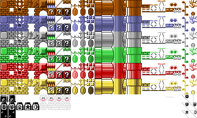
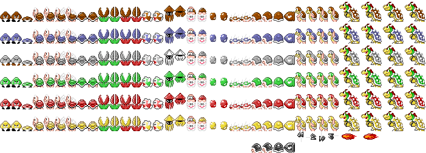
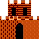
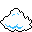
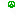

# 🍄 Super Mario

A Unity-based 2D side-scrolling platformer inspired by classic Super Mario Bros. Collect coins, stomp enemies, and reach the flagpole!

---

## 🎮 Overview

A classic-style 2D platformer built in Unity featuring:

- **Tile-based level design** — Ground blocks, bricks, pipes, and castle structures
- **Enemy AI** — Goomba-style walking enemies
- **Collectibles** — Coins, 1-up mushrooms, power-up mushrooms
- **Level progression** — Castle end-flag, hill backdrops, cloud layers
- **Classic mechanics** — Empty blocks (breakable), pipes (underground/overground)

---

## 🛠️ Technology Stack

| Layer | Technology |
|-------|-----------|
| Game engine | Unity |
| Programming | C# |
| Sprites | Custom sprite sheets (Enemies, Blocks, Castle, Clouds, etc.) |
| Level design | Prefab-based scene construction |

---

## 📁 Repository Contents

- `Assets/Prefab/` — All game object prefabs (enemies, blocks, items, level props)
- `Assets/Sprites/` — Sprite sheets and individual sprite assets
- `README_images/` — Sprite previews

---

## 🖼️ Sprite Gallery

| Blocks | Enemies | Castle | Cloud | Flag | Goomba |
|--------|---------|--------|-------|------|--------|
|  |  |  |  |  |  |

---

## 🎯 Key Prefabs

| Prefab | Purpose |
|--------|---------|
| `GroundBlock.prefab` | Terrain ground tiles |
| `Brick.prefab` | Breakable / solid brick blocks |
| `EmptyBlock.prefab` | Invisible hitbox blocks |
| `PipeBottom.prefab` | Warp pipes |
| `Goomba.prefab` | Walking enemy |
| `BlockCoin.prefab` | Collectible coins |
| `1upMushroom.prefab` | Extra life pickup |
| `MagicMushroom.prefab` | Size-shifting power-up |
| `FlagPole 1.prefab` | Level exit |
| `Castle 1.prefab` | End-level fortress |
| `Cloud1.prefab` | Background decoration |
| `Hill1.prefab` | Background hills |

---

## 🚀 Running the Project

1. Open `SuperMario.sln` in Unity
2. Restore packages
3. Open a scene and press Play

---

*This repository is private. © 2026 Ranym Moussa.*